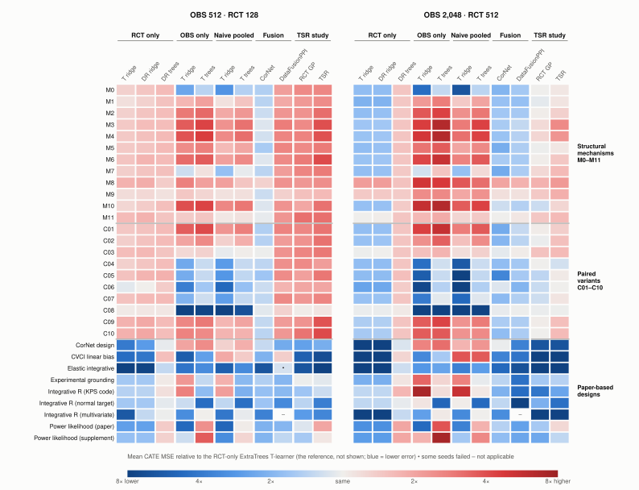

# OBS–RCT Benchmark

Suppose you have a small randomized trial (RCT) and a larger observational sample (OBS) whose treatment assignment may be confounded. Does the OBS sample help you estimate conditional average treatment effects (CATE) better than the trial alone? This repository is a benchmark for that question, for researchers who develop or evaluate methods that combine the two.

It provides:

- **31 simulated scenarios ("presets") with known true CATE.** Nine come from the simulation designs of six published papers. Twenty-two are structural: twelve mechanisms and ten paired variants that vary hidden confounding, bias shape and population shift.
- **One method interface and a set of methods.** Simple baselines are built in. Adapters run four published fusion methods and the `grf` causal forest from their authors' code, and one further fusion method is reimplemented here.
- **Result packets.** They keep every fit, its seed and any failure, together with the code and environment that produced it.

**Main finding so far.** The full catalog comparison covers the baselines, CorNet, DataFusionPPI and the reimplemented TSR estimator. Against a single RCT-only learner (the reference below), CorNet looks good at every budget and DataFusionPPI with the larger trial. Against all four RCT-only learners in the catalog, only CorNet has lower error in most presets, and only with the smaller trial: 24 of 31 presets with RCT 128 at either OBS size, but 13 of 31 with RCT 512. These results come from synthetic presets inspected during development. They do not show how the methods behave on real data.

This is a research alpha, version 0.3.0a6. The [technical report](docs/REPORT.md) ([PDF](https://github.com/snu-causality-lab/obs-rct-benchmark/releases/download/report-2026-10-30-r2/obsrct_benchmark_icml.pdf)) is an AI-generated research draft from October 2026. It is not peer reviewed and predates the TSR study.

## What is implemented

### Methods

Each method is registered as one or more *recipes*, a method with fixed settings. There are 21 recipes, counting variants and controls; `obs-rct-benchmark list-methods` prints them.

| Method | Paper | Data used | Code | Results |
| --- | --- | --- | --- | --- |
| T-learner and DR-learner, each with Ridge or ExtraTrees | Standard baselines | RCT only, OBS only, or both pooled naively (T-learner); RCT only (DR-learner) | This package | Figure below |
| RCT-only learner chosen from the four RCT-only baselines by out-of-fold error on trial data (`rct_selected`) | R-loss of Nie and Wager (2021), divided by e(1 − e) so it targets unweighted CATE error | RCT only | This package | Reference of the planned [v1 core study](docs/V1_CORE_STUDY.md); not yet run |
| CorNet, with standardized inputs and with raw inputs (`cornet_raw`) | Hatt et al. (2022) | OBS and RCT | Authors' code at a pinned commit, cloned separately | Figure below (standardized only) |
| DataFusionPPI | Jung and Yang (2026) | OBS and RCT | Authors' package at a pinned revision | Figure below |
| Integrative R-learner, linear and quadratic bases | Wu and Yang (2022) | OBS and RCT | Authors' R code at a pinned commit | [Native panel](results/native_panel/SCIENTIFIC_RESULT.md) |
| Causal-ICM with borrowing fixed at ρ = 0.5, plus two source-restricted controls | Dimitriou et al. (2026) | OBS and RCT | Authors' code, hash-verified. The paper's selection of ρ is not implemented | [Native panel](results/native_panel/SCIENTIFIC_RESULT.md), [GP experiment](results/gp_source_pilot/SCIENTIFIC_RESULT.md) |
| Honest causal forest | Athey, Tibshirani and Wager (2019) | RCT only | `grf` 2.6.1, pinned | [Native panel](results/native_panel/SCIENTIFIC_RESULT.md) |
| Two-stage residual (TSR) estimator from R-Design, plus RCT-only GP and OBS-only controls | Gao et al. (2026) | OBS and RCT | **Reimplemented here.** A TabPFN v2 model fitted on OBS is the offset; a two-output Gaussian process (GP) corrects it on trial residuals. The paper's adaptive acquisition rule is not implemented | Figure below, [TSR study](results/tsr_study/SCIENTIFIC_RESULT.md) |

Optional recipes need more than the core install. Integrative R and the causal forest need R and the pinned upstream code. Causal-ICM needs the authors' code, and TSR needs the `tsr` extra and a TabPFN v2 checkpoint, with a GPU recommended. See [native settings](docs/V03_ADAPTERS.md), [installing upstream code](#public-upstream-methods) and the [TSR packet](results/tsr_study/README.md).

The adapters run each method with its authors' default settings; the docs call these *native* recipes. The benchmark does not tune them, and they do not reproduce every paper's reported results. No published adaptive-design method is implemented yet. The [sequential recruitment track](docs/ADAPTIVE.md) has uniform, geometry-based and outcome-assisted reference policies.

### Scenarios

| Group | Presets | What varies |
| --- | --- | --- |
| Paper-based designs | 8 translations and 1 explicit extension from six papers | Each paper's own simulation, with adaptations stated |
| Structural mechanisms | M0–M11 | M0 has no hidden confounding. M1–M11 add hidden treatment selection of different shapes, effect complexity, study participation and source shift |
| Paired variants | C01–C10 | One stated change to a structural mechanism, other components kept |
| Empirical covariates | Your own IHDP NPZ/CSV or ACIC2016 CSV files | Hide selected covariates and generate new OBS/RCT samples with exact finite-population targets |
| Marginal sensitivity model | Constant Γ or a user-defined Γ(X) | Hidden treatment selection, controlled separately from outcomes and source shifts |

The six papers are CorNet, Experimental Grounding, the Integrative R-learner, Elastic Integrative analysis, power likelihood and CVCI. For four of them (Experimental Grounding, Elastic Integrative, power likelihood and CVCI) only the simulation design is included, not the estimator. The Integrative R-learner normal-target extension deliberately evaluates outside the Uniform[-1,1] trial support; the original paper and code use a Uniform[-1,1] test population. Variants of one source are not counted as independent papers. See the [paper cards](docs/PAPER_DGPS.md), [scenario descriptions](docs/COVERAGE.md) and [extraction notes](docs/DGP_EXTRACTION.md).

## Results at a glance

<picture>
  <source media="(prefers-color-scheme: dark)" srcset="docs/figures/catalog_relative_mse_dark.svg">
  
</picture>

The [catalog study](results/catalog_study/SCIENTIFIC_RESULT.md) ran each preset at four budgets: OBS 512 or 2,048 rows, crossed with RCT 128 or 512 training rows, 64 seeds each. Each fit is scored by CATE mean squared error (MSE) against the true CATE at 2,048 evaluation points. The figure shows the smallest and largest budgets.

Rows M0–M11 are the structural mechanisms; M0 has no hidden confounding. Rows C01–C10 each change one component of a structural mechanism. The last nine rows are the paper designs. "Integrative R (KPS code)" is that paper's Simulation I, generated by its released code's option for Kallus, Puli and Shalit's data. DataFusionPPI is not applicable to Integrative R (multivariate), whose trial propensity depends on covariates. The [scenario descriptions](docs/COVERAGE.md) define every row.

Each cell divides a recipe's mean MSE by that of the RCT-only ExtraTrees T-learner in the same preset and budget. That learner, the *reference*, has no column because its ratio is always 1. The catalog study chose it before seeing results, as one of two nonlinear RCT-only controls. It turned out to be weak at RCT 512, which makes every recipe look better in the right panel; the table therefore also counts against all four RCT-only recipes. The TSR and RCT GP columns come from the separate [TSR study](results/tsr_study/SCIENTIFIC_RESULT.md). Its reruns of the catalog's two RCT-only T-learners reproduced the catalog's published per-seed scores exactly, so both studies used the same samples.

| Recipe | vs reference, OBS 512 · RCT 128 | vs reference, OBS 2,048 · RCT 512 | vs all RCT-only, OBS 512 · RCT 128 | vs all RCT-only, OBS 2,048 · RCT 512 |
| --- | ---: | ---: | ---: | ---: |
| TSR (reimplemented) | 7/31 | 11/31 | 2/31 | 3/31 |
| RCT-only GP (TSR control) | 9/31 | 20/31 | 2/31 | 4/31 |
| CorNet | 30/31 | 29/31 | 24/31 | 13/31 |
| DataFusionPPI | 7/30† | 26/30 | 3/30† | 3/30 |
| Naive pooled T ridge | 13/31 | 11/31 | 10/31 | 7/31 |
| Naive pooled T trees | 12/31 | 10/31 | 10/31 | 2/31 |
| OBS-only T ridge | 13/31 | 11/31 | 9/31 | 7/31 |
| OBS-only T trees | 11/31 | 9/31 | 8/31 | 2/31 |
| RCT-only T ridge | 10/31 | 29/31 | — | — |
| RCT-only DR ridge | 9/31 | 28/31 | — | — |
| RCT-only DR trees | 4/31 | 4/31 | — | — |

Each entry counts presets where the recipe's mean MSE is lower than the reference's, or lower than all four RCT-only recipes'. † Some seeds failed in one preset; that mean uses successful fits only. DataFusionPPI is not applicable to one preset.

- **The reference is weak at RCT 512.** An RCT-only ridge T-learner also beats it in 29 of 31 presets. Beating the reference alone is therefore not evidence that OBS helped.
- **Against every RCT-only recipe, fusion gains are smaller at the larger budget.** CorNet is lower in 24 of 31 presets at OBS 512 · RCT 128, and in 13 of 31 at OBS 2,048 · RCT 512. DataFusionPPI is lower in 3 of 30 at both.
- **R-Design's estimator alone did not help.** The TSR study tested TSR against its matched RCT-only GP in 120 conditions: 30 presets × 4 budgets, leaving out the heavy-tailed M11. TSR was significantly better in 4, all in the one preset whose target lies outside the trial's support, and significantly worse in 49.
- **OBS-only and naive pooling help where OBS bias is small and hurt where hidden confounding is strong.** They are blue in several paired and paper presets. They are red in most structural mechanisms, for example M2–M6 and M10.

The catalog means are descriptive. The catalog study prespecified Holm-adjusted tests but withheld every decision, because four contrasts lack complete pairs. "Lower than all four RCT-only recipes" is a stricter descriptive bar, not a procedure: choosing the best RCT-only recipe requires evaluation truth. [`scripts/render_overview.py`](scripts/render_overview.py) regenerates the figure and table from the published scores.

## Quick start

Python 3.11 or newer is required. The core uses NumPy; the baseline extra adds scikit-learn.

```bash
git clone https://github.com/snu-causality-lab/obs-rct-benchmark.git
cd obs-rct-benchmark
python -m pip install -e '.[baselines,test]'
obs-rct-benchmark list-methods
obs-rct-benchmark run --config configs/quickstart.toml --output outputs/quickstart
```

The runner writes per-replicate records, a machine-readable summary and a Markdown report. `--resume` checks that the configuration is unchanged and skips finished records; changed configurations and duplicate IDs are rejected. Failures or incomplete coverage produce a nonzero exit and remain visible.

For execution coverage across all 31 presets:

```bash
obs-rct-benchmark run --config configs/smoke.toml --output outputs/catalog-smoke
```

The full test suite and release checks are separate from these small examples:

```bash
python -m pytest
python scripts/check_release.py
```

Quickstart uses two designs and two seeds; catalog smoke uses all 31 designs and the same two seeds. Both use OBS 120, RCT training 60, tuning 30, test 30 and evaluation 128 rows per design/seed. These bounded examples check execution, not method rankings. See [verification scopes](docs/VERIFICATION.md) and [stored examples](results/README.md#original-alpha-execution-examples).

## Read the results

Each study has its own frozen code version, target, budgets and inference rules. The [results index](results/README.md) gives coverage and failures for each, and each packet's README gives the commands that reproduce it.

| Study | Folder | Question |
| --- | --- | --- |
| [Full catalog comparison](results/catalog_study/SCIENTIFIC_RESULT.md) | `results/catalog_study` | Ten recipes on all 31 presets at four budgets; the figure above |
| [TSR static study](results/tsr_study/SCIENTIFIC_RESULT.md) | `results/tsr_study` | Does R-Design's estimator help without its acquisition rule? |
| [Native panel](results/native_panel/SCIENTIFIC_RESULT.md) | `results/native_panel` | Authors' code at default settings, including Integrative R, Causal-ICM and the causal forest, on six mechanisms at two trial budgets |
| [Controlled GP experiment](results/gp_source_pilot/SCIENTIFIC_RESULT.md) | `results/gp_source_pilot` | Does OBS help one fixed GP as OBS bias grows? |
| [Matched-M2 comparison](results/reference_study/SCIENTIFIC_RESULT.md) | `results/reference_study` | CorNet and DataFusionPPI against nonlinear RCT-only controls on four matched variants of M2 |
| [Recruitment comparison](results/adaptive_reference/SCIENTIFIC_RESULT.md) | `results/adaptive_reference` | Does choosing which trial subjects to recruit help, when every acquired outcome is charged? |
| [Paper-reported values](results/reported_values/README.md) | `results/reported_values` | Published CorNet and Integrative R results against reruns of the authors' code and the benchmark at the papers' settings |

**Planned, not yet run:** the [v1 core study](docs/V1_CORE_STUDY.md) reruns the catalog methods on fresh seeds against an RCT-only reference chosen from trial data alone, with CorNet in both input forms. Its plan was fixed before any of its fits.

The studies distinguish three claims: improving an OBS starting prediction, benefiting from OBS within one learner, and outperforming another available procedure. In the controlled GP experiment, which fixes one Causal-ICM GP and varies how biased the OBS sample is, OBS lowers mean trial-CATE MSE at discrepancy levels 0 and 1 and raises it at level 2, relative to the matched RCT-only GP, at both trial budgets. In the native panel's M2 condition at RCT 128, adding OBS lowers the GP's mean MSE from 0.53675 to 0.35128, while the RCT-only causal forest has 0.18386. These are descriptive comparisons; the native panel withheld all its joint decisions.

The [comparison design](docs/V03_DESIGN.md) separates the remaining method, matched-control, target and observable-tuning questions. Its [method inventory](docs/V03_METHODS.md) has 22 method or method-group entries; the [scenario map](docs/V03_SCENARIOS.md) classifies all 31 presets by target, support and transport assumptions.

## More on the scenarios

The [empirical-data interface](docs/DATASETS.md#local-file-adapters) reads separately obtained files and defines new semi-synthetic OBS/RCT problems; it does not preserve the source experiment's treatment assignments or noisy outcomes. The [Γ/Γ(X) factory](docs/SENSITIVITY.md) preserves a specified marginal propensity and checks the sensitivity bound at evaluated covariates. Configuration files support constant and logistic Γ profiles; the Python API accepts pointwise callbacks. The factory implements one configurable construction within the marginal sensitivity model.

## Choose an evaluation track

- **Static estimation:** compare fixed observed-data recipes across named conditions and OBS/RCT sample budgets. Optional condition labels let one DGP appear at several budgets without changing its sampling seed. Reports show each condition's scores, paired differences, eligible intervals and failures. See the [protocol](docs/PROTOCOL.md) and [budget-grid example](docs/EXTENDING.md).
- **Sequential recruitment:** reveal a common pilot, choose additional trial subjects from an outcome-hidden candidate pool, then fit at fixed outcome budgets. Every acquired outcome is charged. Uniform, geometry and outcome-assisted reference policies are included. See the [adaptive protocol](docs/ADAPTIVE.md).

## Learn with notebooks

Start with the [executed notebook tutorials](notebooks/README.md). They combine editable controls, explanations, plots and small checks:

1. [First comparison](notebooks/01_first_comparison.ipynb): generate OBS/RCT samples, compare fixed baselines and interpret CATE/region errors.
2. [Gamma and assumptions](notebooks/02_gamma_and_assumptions.ipynb): separate hidden treatment selection, outcome loadings and source shifts.
3. [Empirical covariates](notebooks/03_empirical_covariates.ipynb): understand masking, coarsening and displayed-X targets; optionally connect your IHDP/ACIC files.
4. [Custom methods and reproducibility](notebooks/04_custom_method_and_reproducibility.ipynb): add an estimator, read paired comparisons, preserve failures and resume runs.
5. [Multi-source identification](notebooks/05_multisource_identification.ipynb): enumerate a counterexample where complementary RCT covariates do not identify joint CATE. This is a mathematical tutorial; the package's current source contract is unchanged.

Install `python -m pip install -e '.[baselines,notebooks]'` for JupyterLab and execution dependencies. The default notebooks use synthetic data and include stored outputs; no external dataset or official method checkout is needed. Their small runs are teaching examples, not method-ranking evidence.

## Public upstream methods

DataFusionPPI is optional and installed from the revision recorded in [sources.lock.toml](sources.lock.toml):

```bash
python -m pip install -e '.[datafusionppi]'
```

The CorNet adapter uses a separate, clean checkout because upstream code is not bundled:

```bash
python -m pip install -e '.[cornet]'
git clone https://github.com/tobhatt/CorNet.git _upstreams/CorNet
git -C _upstreams/CorNet checkout 38b9c37d5a86bc87950945d6ddb1ceb5354a45ba
export CORNET_SOURCE="$PWD/_upstreams/CorNet"
obs-rct-benchmark run --config configs/official_smoke.toml --output outputs/official-smoke
```

The official smoke configuration uses reduced CorNet training epochs to verify integration. Default adapter settings use 500 source epochs and 200 correction epochs, a three-layer width-25 representation, full-batch SGD and optional OBS-fitted standardization. CorNet fits the representation on OBS and the released armwise correction on RCT training data. DataFusionPPI uses its own three-way rotated splits within the RCT training sample. These fixed recipes do not consume the separate RCT tuning sample. The [protocol](docs/PROTOCOL.md) describes sample use and optimization.

The RCT-only forest uses a separately built, pinned `grf` installation, known trial assignment probabilities and native outcome nuisances. Its [installation and build-record instructions](docs/CAUSAL_FOREST.md#source-installation-and-runtime-binding) preserve a pristine upstream checkout and bind the selected source, installed package and runtime evidence. Upstream code is not bundled.

The benchmark's MIT license covers its original code. External sources retain their own terms; public availability alone is not a redistribution license. See [third-party notices](THIRD_PARTY_NOTICES.md).

## Evaluation contract

`TrainingView` separates OBS training, RCT training, RCT tuning and permitted outcome-free target covariates. The [GP source controls](docs/GP_SOURCE_PILOT.md) and [RCT-only forest](docs/CAUSAL_FOREST.md) use narrower included-sample-only entries. `eval_X` is for prediction only; preprocessing, density estimation and adaptation use permitted training data or a separate `target_reference`. Latent confounders, evaluation outcomes and effect truth remain evaluator-owned. The interface helps prevent accidental leakage; it is not a security sandbox.

Supported generators supply an independent target-covariate sample when `n_target_reference>0`; the default is none. `rct_test` is reserved for evaluator factual diagnostics. CATE scoring uses `eval_tau` at `eval_X`, without RCT test outcomes. Methods within a scenario/seed receive identical permitted samples. See the [protocol](docs/PROTOCOL.md) and [extension guide](docs/EXTENDING.md) for role, prediction and failure contracts.

CATE MSE is `mean((prediction - target_cate)**2)`; per-replicate root-PEHE is its square root. Paired comparisons use shared replicate seeds and retain failed/missing cases. Generic Student-t uncertainty requires complete pairs, at least two seed blocks and [metric-specific permission](docs/INFERENCE.md) in every contributing condition. Under Student-t(3) outcome noise, mean-MSE uncertainty is not reported; root-PEHE has a separate policy. Native, external and custom recipes need explicit assumptions. Permission does not establish finite variance or reliable small-sample coverage; frozen studies retain their own analysis rules.

Paper translations, constructed stresses and empirical-covariate designs answer different questions. Empirical targets condition on displayed covariates; dropping a covariate need not create residual confounding in a finite empirical distribution. A common Γ treatment-selection bound can coexist with different outcome loadings and source shifts. The [dataset contract](docs/DATASETS.md#local-file-adapters) and [sensitivity model](docs/SENSITIVITY.md) state these distinctions.

## Add a method or DGP

Use the public package from a separate research repository and implement `fit_predict(training, eval_X, *, seed)`. The [custom-method example](examples/run_custom_method.py) and [extension guide](docs/EXTENDING.md) show the interface. The benchmark does not need access to that research repository.

Contributions should include source attribution, explicit adaptations and checks of the target and information contract. See [CONTRIBUTING.md](CONTRIBUTING.md). Cite this software using [CITATION.cff](CITATION.cff), and cite the original papers for the designs or methods used.

## References

These research sources have different roles in the benchmark. A translated DGP does not imply that the paper's estimator is implemented.

| Paper | DGP translation | Method adapter |
| --- | --- | --- |
| Hatt et al. (2022), [Combining Observational and Randomized Data for Estimating Heterogeneous Treatment Effects](https://arxiv.org/abs/2202.12891v1) | CorNet simulation | Optional official CorNet |
| Kallus, Puli and Shalit (2018), [Removing Hidden Confounding by Experimental Grounding](https://arxiv.org/abs/1810.11646v1) | Experimental Grounding simulation | Not included |
| Wu and Yang (2022), [Integrative R-learner of heterogeneous treatment effects combining experimental and observational studies](https://proceedings.mlr.press/v177/wu22a.html) | Two translations and an explicit target extension | Optional native linear/quadratic recipes |
| Yang et al. (2022), [Elastic Integrative Analysis of Randomized Trial and Real-World Data for Treatment Heterogeneity Estimation](https://arxiv.org/abs/2005.10579v3) | Elastic Integrative simulation | Not included |
| Lin, Tarp and Evans (2025), [Combining experimental and observational data through a power likelihood](https://academic.oup.com/biometrics/article/81/1/ujaf008/8016472) | Paper and supplement variants | Not included |
| Yang et al. (2025), [Cross-Validated Causal Inference: a Modern Method to Combine Experimental and Observational Data](https://arxiv.org/abs/2511.00727v1) | CVCI linear simulation | Not included |
| Jung and Yang (2026), [Prediction-Powered Data Fusion for Treatment Effect Estimation](https://arxiv.org/abs/2610.12332v2) | Not included | Optional official DataFusionPPI |
| Dimitriou et al. (2026), [Causal-ICM](https://proceedings.mlr.press/v323/dimitriou26a.html) | No source-paper DGP translation; a separate [controlled GP experiment](results/gp_source_pilot/README.md) is available | Optional fixed-rho native GP recipe and source controls |
| Athey, Tibshirani and Wager (2019), [Generalized Random Forests](https://arxiv.org/abs/1610.01271) | Not included | Optional RCT-only honest `grf` recipe |
| Gao et al. (2026), [Observationally Informed Adaptive Causal Experimental Design](https://arxiv.org/abs/2603.03785v1) (R-Design) | Not included | Reimplemented TSR estimator and matched controls; acquisition rule not included |
| Hollmann et al. (2025), [Accurate predictions on small data with a tabular foundation model](https://doi.org/10.1038/s41586-024-08328-6) (TabPFN v2) | Not included | Used as the TSR OBS model; not a fusion method |
| Nie and Wager (2021), [Quasi-oracle estimation of heterogeneous treatment effects](https://doi.org/10.1093/biomet/asaa076) | Not included | Basis of the selection score in `rct_selected`; not a fusion method |

For empirical benchmark provenance, see Hill (2011), [Bayesian Nonparametric Modeling for Causal Inference](https://doi.org/10.1198/jcgs.2010.08162), and Dorie et al. (2019), [Automated versus Do-It-Yourself Methods for Causal Inference: Lessons Learned from a Data Analysis Competition](https://doi.org/10.1214/18-STS667). [Dataset sources and terms](docs/DATASETS.md) distinguish the original IHDP archive, semi-synthetic IHDP releases and the ACIC2016 package. No dataset is bundled with this repository.

For benchmark-design background, Curth, Svensson, Weatherall and van der Schaar (2021), [Really Doing Great at Estimating CATE? A Critical Look at ML Benchmarking Practices in Treatment Effect Estimation](https://datasets-benchmarks-proceedings.neurips.cc/paper/2021/hash/2a79ea27c279e471f4d180b08d62b00a-Abstract-round2.html), examines how semi-synthetic assumptions and evaluation metrics affect CATE comparisons.
