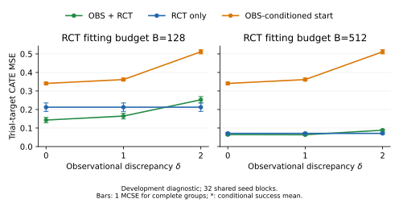
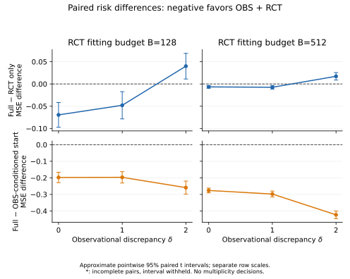

# GP source-access pilot

The full fixed native GP has lower mean risk than its matched RCT-only fit at delta0/1, and higher mean risk at delta2. Each condition's full mean risk is also below its prior-shrunken OBS-conditioned starting prediction, which is not an optimal OBS-only comparator. Read [the complete scientific result](SCIENTIFIC_RESULT.md) for all six conditions and the bounded interpretation.

- **Coverage:**576 successful comparative fits, zero failures, zero missing;32 shared sample-seed blocks per condition, three source-access procedures, OBS512, RCT128/512, query1024.
- **Inference:**12 condition-specific paired descriptive means/MCSEs and unadjusted pointwise t31 intervals. No p-values, multiplicity decisions or global ranking.
- **Checks:**all576 saved scalar risks independently reconstructed,18 means/12 paired summaries checked,160 exclusion-invariance groups verified;18 fixed first-seed fits freshly replayed with maximum prediction difference0. Completed-run resume preserved all576 terminal records byte-for-byte with zero refits. [Execution/check summary](checks_summary.json).
- **Identity:**frozen producer [a645821](https://github.com/snu-causality-lab/obs-rct-benchmark/commit/a645821ea187cea2bb95de535d2b1bee5564bb41), package0.3.0a2; [pre-run binding](producer_binding.json), [full manifest](manifest.json), [analysis](summary.json), [independent verification](verification/verification.json), [replay subset](verification/replay.json).

## Figures and complete scalar tables

[Six-condition wide table](rendered/condition_summary.csv) · [18 recipe summaries](rendered/condition_scores.csv) · [12 paired contrasts](rendered/paired_contrasts.csv) · [576 scalar records](rendered/scalar_records.csv) · [cost/label table](rendered/cost_summary.csv) · [renderer interpretation](rendered/README.md).

Figure bars show one MCSE for complete recipe-risk groups, and approximate pointwise95% paired intervals for contrasts. Negative paired differences favor full. Paired-figure rows have different vertical scales. [The original renderer manifest](rendered/figure_source.json) binds its server outputs, including PDF paper assets retained on GSDS/Overleaf; PDFs are intentionally omitted here. The current public packet's hashes are in [DELIVERY_MANIFEST.json](DELIVERY_MANIFEST.json).

## Reproduction and retained evidence

The [prospective protocol](../../docs/GP_SOURCE_PILOT.md), [configuration](../../configs/gp_source_pilot.toml), [source-only controls](../../src/obs_rct_benchmark/causal_icm.py), [producer](../../scripts/run_gp_source_pilot.py), [preflight checker](../../scripts/verify_gp_source_pilot.py), [independent result checker](../../scripts/verify_gp_source_results.py) and [renderer](../../scripts/render_gp_source_pilot.py) define the checked procedure. The frozen numerical environment follows the [native adapter environment specifications](../native_adapter_admission/environment/README.md).

Raw observations, evaluator truth, predictions, terminal artifacts and full logs remain on GSDS. Fitted GP model pickles and complete optimized kernel state were not saved. This compact packet contains source/configuration bindings, scalar records, aggregates, selected verification records and SVG figures. It supports the documented checks and18-fit replay scope, not original-array access from GitHub or all-fit refitting. Earlier public result directories are preserved.

The frozen producer suite passed371 tests with one unconfigured external-CorNet integration skipped on Python3.11.17; that integration passed separately on the previously configured Python3.12.3/Torch environment. The [native/data preflight](verification/preflight.json) passed13 tiny native fits. The separate helper smoke job721910 completed24 outside-panel fits, analysis and rendering, but its verifier invocation rejected the non-frozen smoke configuration. This retained orchestration mismatch was not a planned negative test, a main-panel numerical failure or a reason to replace a score. Main-panel independent verification and replay passed without changing the scientific source/configuration.
